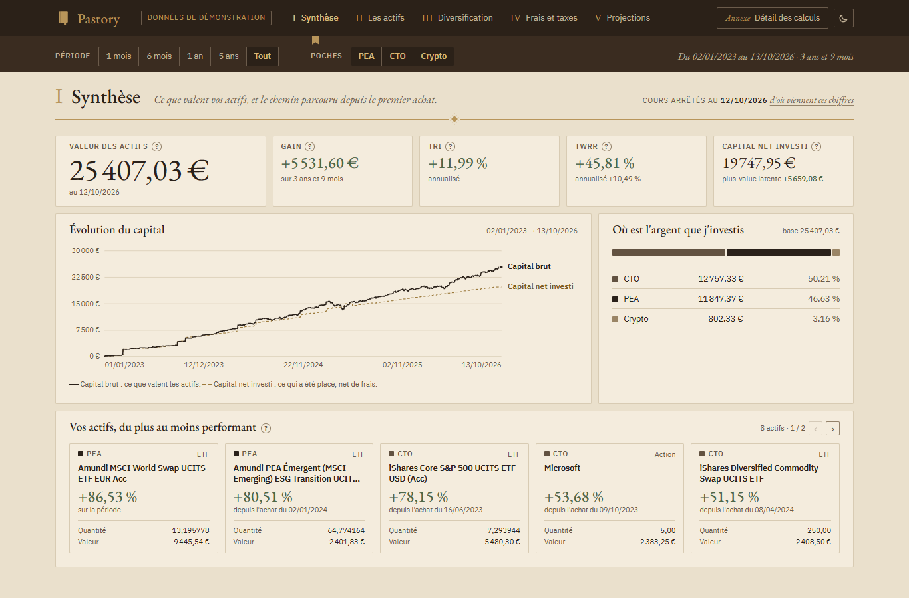
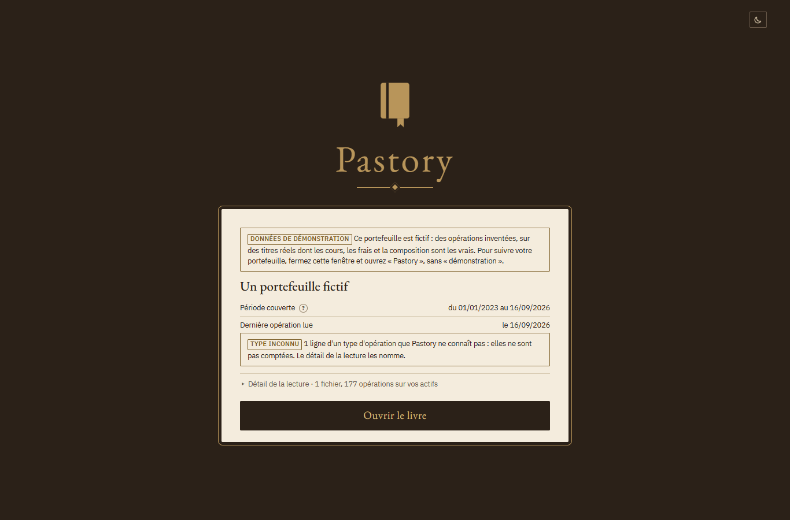
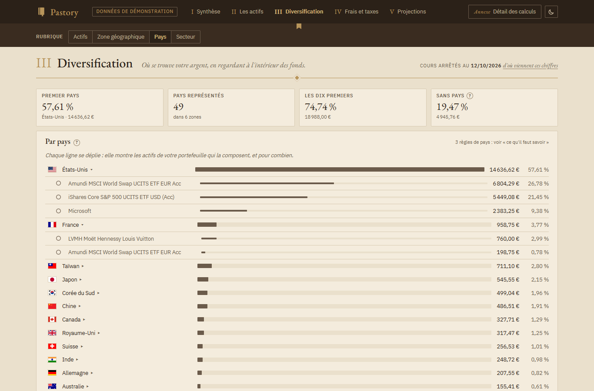

# Pastory

Tableau de bord **local** et **gratuit** pour suivre les actifs d'un portefeuille Trade Republic
(PEA, compte-titres, crypto), destiné aux investisseurs long terme. Vous déposez l'export de vos
transactions ; Pastory en tire ce que valent vos actifs, ce qu'ils ont rapporté, ce qu'ils coûtent,
et où se trouve votre argent. **Vos données ne quittent jamais votre ordinateur.**

**Projet indépendant, sans aucun lien avec Trade Republic** : il lit le fichier que la banque
fournit à ses clients, et rien d'autre. Ce n'est ni un conseil en investissement, ni une
déclaration fiscale.



*Le portefeuille de démonstration livré avec Pastory : des opérations inventées, sur des titres
réels.*

| | |
|---|---|
|  |  |
| **On dépose l'export, et c'est tout** : les cours, les frais des fonds et leur composition sont trouvés seuls. | **Où se trouve l'argent**, en regardant à l'intérieur des fonds — pays, zones, secteurs, classes d'actifs. |

> **Où en est le projet.** Pastory fonctionne de bout en bout sous Windows et s'ouvre comme un
> logiciel ; il s'installe aussi sous Linux et macOS, où il reste à éprouver. Reste à faire :
> les écrans pour corriger à la main une valeur trouvée (aujourd'hui, un fichier). Le détail est dans
> [docs/feuille-de-route.md](docs/feuille-de-route.md).

## Installer Pastory

### Sous Windows

Deux étapes, une seule fois. Aucune commande à taper.

1. **Téléchargez Pastory** (sur GitHub : *Code* → *Download ZIP*), puis **décompressez
   l'archive** : clic droit sur le fichier ZIP → *Extraire tout*. Rangez le dossier obtenu où
   vous voulez le garder — **de préférence hors de OneDrive** (donc pas sur le bureau s'il est
   synchronisé), par exemple dans `C:\Pastory`.

2. **Double-cliquez sur `Installer Pastory.cmd`**, dans ce dossier. Une fenêtre noire s'ouvre et
   fait tout :
   - elle installe **`uv`**, l'outil libre qui installera Python et les bibliothèques, s'il n'est
     pas déjà sur votre ordinateur — elle vous le dit et attend que vous appuyiez sur une touche
     ([sa méthode officielle](https://docs.astral.sh/uv/getting-started/installation/)) ;
   - elle installe l'environnement de Pastory, dans ce dossier (quelques minutes la première
     fois) ;
   - elle crée l'icône **Pastory** sur le bureau et dans le menu Démarrer.

Si Windows affiche un avertissement au lancement du fichier (« Windows a protégé votre
ordinateur »), c'est parce qu'il vient d'être téléchargé : *Informations complémentaires* →
*Exécuter quand même*.

Si l'installation échoue, la fenêtre dit pourquoi, et il suffit de **relancer le fichier** une fois
la cause levée. Les causes rencontrées jusqu'ici : le fichier lancé **depuis l'archive ZIP**, sans
l'avoir décompressée ; un **antivirus qui inspecte les connexions sécurisées** (message « invalid
peer certificate » : suspendez son analyse HTTPS le temps de l'installation) ; un dossier rangé
dans **OneDrive** (message « Accès refusé » : déplacez-le).

Pastory s'installe avec **Python 3.12**, que `uv` télécharge de lui-même : c'est le fichier
`.python-version` du dossier qui le fixe. Si vous voyez « failed to build », c'est qu'il manque —
téléchargez Pastory de nouveau.

Si vous déplacez ou renommez le dossier de Pastory, relancez `Installer Pastory.cmd` : les icônes
pointent sur lui.

### Sous Linux et macOS

Le fichier `Installer Pastory.cmd` est celui de Windows. Ici, c'est `installer-pastory.sh` :

1. **Téléchargez Pastory** et décompressez l'archive (ou `git clone`).
2. **Dans un terminal, depuis ce dossier :**

   ```
   sh installer-pastory.sh
   ```

Il fait la même chose que sous Windows : il installe `uv` s'il manque (après vous l'avoir dit),
puis l'environnement de Pastory dans ce dossier, puis il ajoute **Pastory au menu des
applications** (Linux) ou pose un fichier **`Pastory.command` sur le bureau** (macOS). Il faut
`curl` ou `wget` ; pour que Pastory s'ouvre dans sa propre fenêtre, Chrome, Chromium ou Edge —
sans eux, il s'ouvre dans un onglet de votre navigateur habituel.

Pastory s'ouvre aussi sans raccourci, depuis ce dossier : `.venv/bin/python -m pastory.lanceur`.

> **Essayé seulement pièce par pièce.** Pastory est développé sous Windows : cet installateur et
> ces raccourcis ont été vérifiés par des tests, pas sur un vrai Linux ni un vrai Mac. Si
> quelque chose ne marche pas chez vous, [dites-le](https://github.com/TheoDuc/Pastory/issues) avec le message affiché.

## Obtenir l'export de vos transactions

Dans l'application Trade Republic : **Profil → Relevés → Export des transactions**. Choisissez
**toutes les transactions**, depuis l'ouverture du compte, puis *Créer*. Vous obtenez un fichier
`Exportation de transactions.csv`.

Un export qui commence plus tard donne une histoire incomplète, et rien dans le fichier ne le
dit : Pastory affiche la période couverte, vérifiez que son premier jour est bien celui de votre
première opération.

## Ouvrir Pastory

**Double-cliquez sur l'icône Pastory.** Une fenêtre s'ouvre sur la couverture du livre :

1. **déposez-y votre export** (glissez le fichier, ou cliquez pour le choisir). C'est la seule
   chose à faire : les cours, les frais des fonds et leur composition sont trouvés seuls, et chaque
   valeur dit d'où elle vient ;
2. **ouvrez le livre** : synthèse, actifs, diversification, frais et taxes, projections.

La première lecture d'un export interroge les sources de cours et de composition : elle demande
Internet et dure de quelques secondes à une minute, selon le nombre d'actifs. **Une barre dit où
elle en est**, actif par actif. Ensuite, tout est gardé sur votre ordinateur, et seuls les derniers
cours sont redemandés.

**Fermer la fenêtre arrête Pastory.** Pour un export plus récent, déposez-le de la même façon :
Pastory reconnaît le même compte à ses opérations, et **met votre portefeuille à jour**.

## Plusieurs portefeuilles

**Un fichier déposé est un portefeuille**, et deux fichiers ne se mélangent jamais. Si vous
déposez l'export d'un autre compte — celui d'un proche, par exemple —, il devient un **second
portefeuille** : la couverture propose alors de choisir lequel ouvrir, et son nom reste affiché
pendant toute la lecture. Chaque portefeuille se renomme et se supprime depuis la couverture,
dans « Détail de la lecture ».

Chacun est calculé seul, comme celui d'une seule personne : il n'y a pas de vue d'ensemble, et
l'impôt estimé de l'un ne tient pas compte des autres. Pastory n'assemble pas non plus deux
exports partiels d'un même compte : exportez toujours **toutes les transactions**.

Si Pastory ne s'ouvre pas, un message le dit, et le détail est écrit dans le fichier `journal.txt`
de son dossier personnel (`%LOCALAPPDATA%\Pastory` sous Windows).

## Essayer sans son portefeuille : la démonstration

Dans le menu Démarrer, **« Pastory (démonstration) »** ouvre un **portefeuille fictif** : des
opérations inventées, sur des titres réels et courants (des fonds indiciels, deux actions, du
bitcoin), répartis entre un PEA, un compte-titres et la crypto. Pastory le lit comme un vrai
export.

La démonstration a son propre dossier, à part du vôtre : rien ne se mêle. L'écran porte
« Données de démonstration » en permanence, et on ne peut pas y déposer d'export.

## Ce que Pastory montre, et ce qu'il ne fait pas

- **La performance est calculée en montants bruts** : gain en euros, TRI et TWRR. Les frais et les
  taxes sont montrés à part, jamais mélangés.
- **Ce qui est estimé est marqué comme tel** : l'écart de prix à l'achat et à la vente, les frais
  courants des fonds, l'impôt si l'on vendait tout. Chaque taux porte sa date et sa source. C'est
  une estimation, pas une déclaration fiscale.
- **Ce qui n'est pas trouvé de façon fiable est un trou affiché**, jamais une valeur inventée ni
  une question posée.
- **Un type d'opération que Pastory ne connaît pas est affiché**, jamais ignoré : Trade Republic
  ne publie aucune liste de ses types.
- **Les cours sont ceux du marché principal en euros**, à la clôture, pas ceux de Trade Republic :
  un écart de quelques dixièmes de pour cent avec votre application est normal.
- **Les espèces ne sont pas suivies**, et les lignes d'espèces de l'export (paiements, virements)
  ne sont que comptées : leurs montants, commerçants et IBAN ne sont jamais lus.
- **Comparez les quantités à celles de votre application.** Des titres entrés sans aucune ligne
  dans l'export — un transfert depuis une autre banque — n'y apparaissent pas.

## Pour aller plus loin : la ligne de commande

Tout ce que montre la fenêtre existe aussi en texte et en CSV, pour vérifier un chiffre dans un
tableur. Dans un terminal, à la racine du dossier :

```
uv run pastory emplacements        où sont rangés vos fichiers (exports, cache, corrections)
uv run pastory lire                le rapport de lecture de vos exports
uv run pastory actifs              ce que Pastory a trouvé seul pour chaque actif, avec sa source
uv run pastory positions           quantités, valeur, gain, TRI, TWRR, coûts, valeur réelle
uv run pastory exporter-positions  les mêmes chiffres en CSV, dont le journal de chaque opération
uv run pastory ouvrir              la fenêtre, depuis un terminal (--demonstration pour l'exemple)
uv run pastory installer           recréer les icônes (--retirer pour les enlever)
uv run pastory --help              toutes les commandes
```

Une valeur trouvée qui vous semble fausse se corrige dans `actifs.toml` (dossier `configuration`,
voir `pastory emplacements`) : la correction l'emporte. Ce n'est jamais nécessaire pour voir le
reste du portefeuille.

Comment refaire un chiffre à la main : les [cahiers de vérification](docs/verification/), étape
par étape.

## Comment c'est construit

```
export d'une banque ──► adaptateur ──► format pivot ──► moteur ──► vues
```

Le moteur ne lit que le **format pivot**, décrit dans [docs/format-pivot.md](docs/format-pivot.md).
Utiliser Pastory avec une autre banque ne demande que d'écrire un nouvel adaptateur
([D-26](docs/decisions.md)).

| Fichier | Contenu |
|---|---|
| [docs/feuille-de-route.md](docs/feuille-de-route.md) | Les étapes du projet et l'étape en cours |
| [docs/architecture.md](docs/architecture.md) | Comment c'est construit, couche par couche |
| [docs/format-pivot.md](docs/format-pivot.md) | Le format des opérations, champ par champ |
| [docs/glossaire.md](docs/glossaire.md) | Chaque notion financière et sa formule |
| [docs/export-officiel.md](docs/export-officiel.md) | Ce que contient l'export de Trade Republic, et ses pièges |
| [docs/sources-de-cours.md](docs/sources-de-cours.md) | D'où viennent les cours, et pourquoi cette source |
| [docs/couts-et-fiscalite.md](docs/couts-et-fiscalite.md) | D'où viennent les spreads, le TER et les règles fiscales |
| [docs/composition-des-etf.md](docs/composition-des-etf.md) | D'où vient la composition des fonds |
| [docs/decisions.md](docs/decisions.md) | Les décisions prises, avec leurs raisons |
| [docs/verification/](docs/verification/) | Comment vérifier les chiffres soi-même |

## Vie privée

Aucune donnée réelle n'entre dans ce dépôt : exports et résultats de vérification sont exclus par
le `.gitignore` et rangés hors du dossier du projet. La documentation n'utilise que des valeurs
fictives. Pastory n'a besoin d'aucun identifiant : il ne se connecte jamais à votre banque.

Pour chercher un cours ou la composition d'un fonds, Pastory envoie le **code du titre** (son
ISIN) ou son nom à des sources publiques — jamais vos quantités, vos montants ni votre identité.

## Les sources, et leurs limites

Pastory interroge des services publics et gratuits, depuis votre ordinateur, pour votre usage
personnel : Yahoo Finance (les cours), extraETF, Amundi et la liste de Xetra (les frais et la
composition des fonds), le registre de l'ESMA et GLEIF. **Aucun de ces services n'est partenaire
du projet, et aucun ne garantit sa disponibilité** : l'un d'eux peut changer ou cesser de
répondre. Pastory affiche alors un trou, avec sa raison — jamais une valeur inventée. Les
comparatifs qui ont conduit à ces choix sont dans [docs/](docs/).

## Sans garantie

Pastory est un outil personnel, publié tel quel. Ses calculs sont documentés et vérifiables à la
main ([docs/verification/](docs/verification/)), mais **rien ne garantit qu'ils soient justes
pour votre situation** : comparez-les à votre application bancaire. L'impôt affiché est une
estimation, fondée sur des règles françaises datées et sourcées ; ce n'est pas un conseil fiscal.

## Comment ce projet a été fait

Par quelqu'un qui ne code pas, avec [Claude Code](https://claude.com/claude-code), étape par
étape : le propriétaire décide et vérifie les chiffres, l'assistant écrit le code et la
documentation. Rien n'est caché de cette méthode : les règles de travail sont dans
[CLAUDE.md](CLAUDE.md), chaque arbitrage dans [docs/decisions.md](docs/decisions.md) (avec ce qui
a été écarté, et pourquoi), et les questions restées ouvertes dans
[docs/questions-ouvertes.md](docs/questions-ouvertes.md).

## Contribuer, adapter à une autre banque

Le moteur ne connaît pas Trade Republic : il ne lit que le
[format pivot](docs/format-pivot.md). Écrire un adaptateur pour une autre banque, c'est produire
ce format à partir de son export ; `pastory/adaptateurs/trade_republic/` en est l'exemple. Les
forks sont les bienvenus.

Pour travailler sur le code : `uv sync`, puis `uv run pytest` et `uv run ruff check .`.

## Licence

Pastory est publié sous licence [MIT](LICENSE).

Il embarque trois œuvres de tiers, chacune avec sa licence, dans son dossier :

- les polices **EB Garamond** et **IBM Plex** (SIL Open Font License 1.1) —
  `pastory/vues/assets/polices/` ;
- les drapeaux de **flag-icons** (MIT) — `pastory/vues/assets/drapeaux/`.

« Trade Republic » est une marque de Trade Republic Bank GmbH, citée ici pour désigner la banque
dont Pastory lit l'export.
